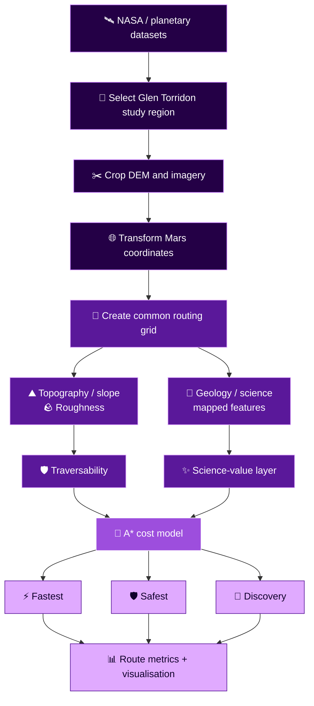

🪐 ✦ 🚀 ✦ 🌌 ✦ 🔭 ✦ 🪐

---

> 🌌 **Glen Torridon Navigator** is a Mars surface-route planning prototype developed for the **NASA Space Apps Challenge**. Our project uses real Mars terrain and geological data to generate mission-aware routes through Glen Torridon in Gale Crater.

Rather than finding only the geometrically shortest path, the algorithm is designed around the needs of a future surface exploration mission. It processes terrain and science datasets into a common grid and uses an A* pathfinding algorithm to compare route choices based on traversability and scientific exploration value.

---

## 🚀 Project Overview

Future astronauts exploring Mars will have to make decisions that go beyond simply travelling from point A to point B. A shorter route may cross steep or rough terrain, while a slightly longer route may offer safer traversal or access to scientifically interesting geological features.

Glen Torridon Navigator converts planetary datasets into decision-ready grid layers that can be evaluated by A*.

At a high level, the project:

1. 🎯 Selects a focused study region within Glen Torridon.
2. ✂️ Crops high-resolution Mars elevation and imagery data to that region.
3. ⛰️ Processes the Digital Elevation Model (DEM) into terrain variables such as slope and traversability.
4. 🪨 Incorporates surface roughness / terrain information.
5. 🔬 Incorporates mapped geological and geomorphological features as indicators of scientific exploration potential.
6. 🧩 Aligns all spatial variables onto a common routing grid.
7. 🧭 Uses A* to search for routes according to different mission priorities.

> 💜 The goal is not to claim flight-ready astronaut navigation. It is a proof of concept showing how NASA and planetary-science datasets can be turned into transparent route-planning decisions for future Mars exploration.

---

## 🎯 Objectives

The main objectives of Glen Torridon Navigator are to:

- 🌍 Demonstrate how real Mars datasets can support future human surface exploration.
- 🧩 Create a common spatial grid that combines multiple planetary datasets consistently.
- ⛰️ Quantify terrain-related traversal difficulty using topography, slope and roughness.
- 🔬 Represent scientifically interesting geological / geomorphological terrain as a spatial exploration-value layer.
- 🧭 Use A* to find explainable routes through the resulting cost grid.
- ⚖️ Enable comparison between mission priorities such as fast traversal, safer traversal and increased scientific opportunity.
- 🔍 Keep the modelling assumptions transparent so that the prototype can later be expanded with higher-fidelity mission constraints.

---

## 🔴 Study Region: Gale Crater and Glen Torridon

The prototype focuses on **Glen Torridon**, on the lower slopes of Mount Sharp in **Gale Crater, Mars**.

Gale Crater was selected because NASA's Curiosity rover has explored the crater since 2012, providing unusually rich orbital and in-situ context for the region. Mount Sharp contains layered sedimentary rocks whose mineralogy records major changes in ancient Martian environments.

Glen Torridon is particularly useful for this project because:

- 🤖 Curiosity physically explored the region during its traverse through Gale Crater.
- 🧱 It contains abundant clay-bearing / phyllosilicate-rich rocks.
- 🌊 The sedimentary record includes environmental transitions between lake-related mudstones and higher-energy fluvial sandstones.
- 🏜️ The area contains mapped geomorphological features including periodic bedrock ridges, ripples and transverse aeolian ridges.
- 🔀 Terrain variation gives the routing algorithm meaningful choices rather than producing a trivial straight-line path.
- 🛡️ The region has both safety-relevant spatial data and scientifically interesting geological context.

The current implementation uses a local study area of approximately **5 km × 5 km** around the selected Glen Torridon centre. Source datasets are transformed and aligned to a common routing grid before being passed to A*.

---

## 🛰️ Data Sources

### 1. ⛰️ Gale Crater Digital Elevation Model

| | |
|---|---|
| **Source** | USGS Astrogeology / NASA / JPL-Caltech, *Mars MSL Gale Merged DEM 1m* |
| **Resolution** | approximately 1 m per pixel in the source product |
| **Used for** | elevation · slope calculation · topographic change · terrain traversability · construction of the base spatial grid |

The DEM combines terrain information derived from HRSC, CTX and HiRISE products tied to the MOLA elevation reference.

🔗 Official source: https://astrogeology.usgs.gov/search/map/mars_msl_gale_merged_dem_1m

### 2. 🖼️ Gale Crater Orthophoto / Colour Mosaic

| | |
|---|---|
| **Source** | USGS Astrogeology / NASA / JPL-Caltech, *Mars MSL Gale Merged Orthophoto Mosaic* |
| **Used for** | visual verification of the selected region · terrain context · checking spatial alignment · displaying routes over the Martian surface |

🔗 Official source: https://astrogeology.usgs.gov/search/map/mars_msl_gale_merged_orthophoto_mosaic_25cm

### 3. 🔬 Glen Torridon Geological / Geomorphological Data

| | |
|---|---|
| **Source** | Published Glen Torridon mapping datasets, including mapped periodic bedrock ridges (PBRs), transverse aeolian ridges (TARs), ripples and related surface features |
| **Used for** | representing mapped geological / geomorphological exploration targets · constructing a relative scientific-discovery layer · rewarding safe routes that approach scientifically interesting exposed terrain |

🔗 Dataset: https://zenodo.org/records/6324330

🔗 A broader geomorphic map of Glen Torridon is also available through Washington University in St. Louis: https://data.library.wustl.edu/record/91

> ⚠️ These mapped features are treated as potential scientific investigation targets, not as direct measurements of mineral concentration.

---

## 🛠️ Implementation

### Core Components

#### ✂️ Data cropping and coordinate handling
The original planetary datasets cover a much larger area than the project requires. Python scripts crop the data to the Glen Torridon study region.

#### ⛰️ Topography and traversability
Elevation gradients from the DEM are converted into slope values. Slope, roughness and terrain rules are then transformed into a traversability / movement-cost representation.

Cells considered unsuitable under the prototype's traversal assumptions can be blocked from A* entirely, while difficult but traversable cells receive a higher movement cost.

> The exact thresholds and weights are modelling assumptions for this hackathon prototype, not NASA-certified astronaut limits.

#### 🪨 Roughness
Surface roughness is incorporated as an additional terrain measure. Rougher areas can receive a greater traversal penalty than locally smoother terrain, helping the routing model distinguish between routes that may have similar overall gradients but different surface difficulty.

#### 🔬 Scientific exploration heuristic
Scientific opportunity is represented separately from safety.

Mapped Glen Torridon geological / geomorphological features are transformed into the same routing coordinate system and used to construct a relative scientific-interest layer. Higher values represent locations closer to selected mapped scientific targets.

> The current science score is a mission-planning heuristic. It does not claim that every grid cell contains a directly measured mineral concentration.

#### 🧭 A* pathfinding
A* is used to search the spatial cost grid efficiently.

A route cost can incorporate terms such as:

- 📏 movement distance;
- ⛰️ slope / topographic difficulty;
- 🪨 roughness / terrain difficulty;
- 🚫 hard traversability constraints;
- 🔬 scientific exploration value.

Different weighting strategies can therefore produce different routes from the same start and end locations:

| Mode | Priority |
|---|---|
| ⚡ **Fastest** | Prioritises travel efficiency while respecting blocked terrain |
| 🛡️ **Safest** | Places more weight on traversability and terrain difficulty |
| 🔭 **Discovery** | Retains the required traversal constraints while favouring routes that approach scientifically interesting mapped features |

---

## 💻 Libraries and Technologies

The project is implemented primarily in **Python**.

| Tool | Role |
|---|---|
| **NumPy** | Numerical matrices used by the routing and terrain-processing pipeline |
| **Rasterio** | Reading, cropping, transforming and aligning GeoTIFF / planetary raster data |
| **PyProj** | Coordinate transformations between Mars geographic coordinates and projected raster coordinates |
| **GeoPandas** | Loading and transforming vector geology / geomorphology data |
| **Shapely** | Geometric operations on spatial features |
| **SciPy** | Array processing and distance / terrain calculations where required |
| **Pandas** | Handling tabular scientific data and metadata |
| **Matplotlib** | Verification plots, terrain maps and route visualisation during development |
| **A* pathfinding** | Graph-search algorithm used to generate mission-specific surface routes |
| **Git / GitHub** | Source control and team collaboration |
| **VS Code** | Primary development environment |

---

## 🌌 Project Workflow

---

## ⚠️ Assumptions and Limitations

Glen Torridon Navigator is a hackathon proof of concept rather than a flight-certified navigation system.

Important limitations include:

- 🎛️ traversal-cost weights are prototype modelling choices;
- 👩‍🚀 astronaut-specific mobility limits are not derived directly from the DEM;
- 🔬 mapped geological features are used as indicators of scientific opportunity rather than definitive science-value ratings;
- 🔍 resampling puts datasets on a common grid but does not increase the native scientific resolution of the source data;
- ❓ incomplete science-data coverage should be treated as unknown rather than automatically uninteresting;
- 🚀 a future operational system would require substantially more detailed EVA, planetary-protection, suit, communications, environmental and mission-planning constraints.

---

## 📚 References

1. USGS Astrogeology Science Center. **Mars MSL Gale Merged DEM 1m.**
   https://astrogeology.usgs.gov/search/map/mars_msl_gale_merged_dem_1m
2. USGS Astrogeology Science Center. **Mars MSL Gale Merged Orthophoto Mosaic 25cm.**
   https://astrogeology.usgs.gov/search/map/mars_msl_gale_merged_orthophoto_mosaic_25cm
3. Stack, K. M. **Shapefiles for Glen Torridon Bedrock Ridges, Ripples, Transverse Aeolian Ridges, Wavelength, and Topographic Profiles.** Zenodo.
   https://zenodo.org/records/6324330
4. Hughes, M. **Geomorphic map of Glen Torridon in Gale crater, Mars.** Washington University in St. Louis.
   https://data.library.wustl.edu/record/91
5. Bennett, K. A., et al. **The Curiosity Rover's Exploration of Glen Torridon, Gale Crater, Mars: An Overview of the Campaign and Scientific Results.** Journal of Geophysical Research: Planets / NASA Technical Reports Server.
   https://ntrs.nasa.gov/citations/20230001618
6. Rudolph, A., et al. **The Distribution of Clay Minerals and Their Impact on Diagenesis in Glen Torridon, Gale Crater, Mars.** Journal of Geophysical Research: Planets, 2022.
   https://agupubs.onlinelibrary.wiley.com/doi/10.1029/2021JE007098
7. Rudolph, A., Johnson, J. **Data for: The distribution of clay minerals and their impact on diagenesis in Glen Torridon, Gale crater, Mars.** Mendeley Data.
   https://data.mendeley.com/datasets/6g3c3g6b9z/1
8. NASA Planetary Data System Geosciences Node. **Mars Science Laboratory - CheMin.**
   https://pds-geosciences.wustl.edu/missions/msl/chemin.htm

---

## 💜 Final Note

### ✨ Glen Torridon Navigator turns existing Mars data into an exploration decision. ✨

By combining topography, surface roughness, mapped geological features and A* route optimisation, the prototype demonstrates how future planetary explorers could balance getting somewhere efficiently with getting there safely and making the journey scientifically worthwhile.

🪐 ✦ 🚀 ✦ 🌌 ✦ 🔭 ✦ 🪐

